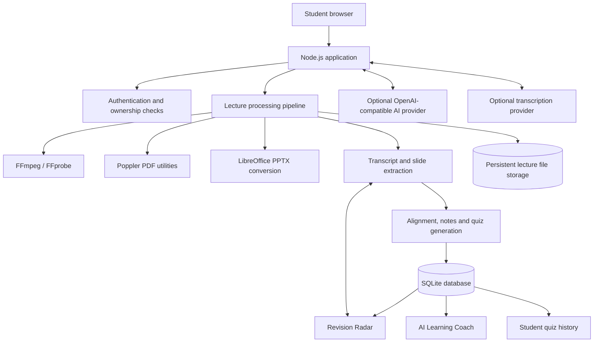

# LectureLens AI

**Turn lectures into searchable, source-linked study material — then use real quiz performance to decide what to revise next.**

LectureLens AI is a student learning workspace that organizes lecture slides and transcripts into timestamped sections, structured notes, and lecture-grounded quizzes. Revision Radar and the Learning Coach use each signed-in student's recorded quiz answers to highlight topics that may need attention.

> **Project status:** Hackathon / early-stage project. The current build includes a one-click judge demo with a guided tour and a private sandbox per visitor, source-linked wrong-answer explanations, lecture processing, visual AI Notes, quizzes, Revision Radar, the Learning Coach, recovery-code password reset, and persistent rate limiting. Optional AI and transcription integrations require provider credentials. A hosted public demo is not currently configured.

---

## The problem

Lecture materials are often split across recordings, slide decks, transcripts, and handwritten notes. Students have to switch between these sources, find where a concept was explained, create revision material, and work out which topics need more practice.

## The approach

LectureLens AI brings those steps into one workflow:

1. **Capture:** upload one lecture recording. A presentation deck and a timestamped VTT/SRT transcript are optional extras.
2. **Transcribe:** if no transcript is supplied, the local faster-whisper integration can create timestamped English-translated speech segments on the computer running the LectureLens AI backend, without a paid API key. Hindi and other supported speech is translated to English by default; use `--task transcribe` for original-language output when running the script manually. A configured hosted transcription provider is also supported.
3. **Organize:** when slides are supplied, extract their text and images and align them to transcript passages. Without slides, create timestamped lecture sections directly from the transcript.
4. **Understand:** read structured notes with transcript source references and visual study aids; export a study guide through the browser's Print → Save as PDF flow.
5. **Practice:** answer multiple-choice questions generated from, or grounded in, the uploaded lecture transcript and any supplied slides.
6. **Improve:** after the student submits a quiz, saved answers populate Revision Radar and the Learning Coach with evidence-based topic priorities.

## What is implemented

| Area | Current capability |
|---|---|
| Student workspace | Email/password sign-up and login; each lecture is associated with its owner. |
| Account recovery | No email service needed: each new account gets a one-time **recovery code** (shown once, stored only as a salted scrypt hash). **Forgot password?** resets the password with that code, rotates the code and signs out all existing sessions. Signed-in students can generate a new code in Settings. |
| Guided tour | In a judge sandbox, a 60-second step-by-step overlay (`public/tour.mjs`) highlights the next click and walks through quiz → wrong-answer explainer → lecture evidence → Revision Radar. It can be skipped and replayed. |
| Judge demo | One-click **Try the judge demo** creates a private, preloaded sandbox for each visitor (auto-deleted after 24 hours). Lecture material is protected from edits/deletion; quiz attempts can be submitted during the walkthrough. |
| Starter learning material | New or empty workspaces are initialized with curated, text-based lessons in Operating Systems, Database Systems, and JavaScript. They are not presented as recordings and do not include fabricated quiz history. |
| Lecture input | Audio/video is required. PDF/PPTX slides and VTT/SRT transcripts are optional. Without slides, transcript-derived lecture sections are created. |
| Local transcription | Optional local `faster-whisper` integration (CPU/int8, `base` model by default; English translation task by default). No paid API key is required; the model is downloaded once on first use. |
| Processing | Media inspection, local or hosted speech transcription, optional slide text/image extraction, transcript parsing, semantic slide/transcript alignment when configured, transcript-derived sections when slides are absent, notes, quizzes, and stage/error reporting. |
| AI Notes | Structured source-based notes; optional AI-assisted explanations; diagrams for recognized topics; source navigation; print-ready PDF export. |
| Quizzes | Lecture-linked multiple-choice questions, saved attempts, and individual answer records. Focused revision sessions submit only their selected question IDs. Incorrect answers can open **Why did I get this wrong?**, which compares the selected and saved correct answers, explains the concept, and displays the exact linked transcript passage and slide reference. |
| Revision Radar | Topic accuracy, attempt history, and revision priorities derived from saved answers. Unassessed topics remain labelled **Not assessed**. |
| AI Learning Coach | A short study plan based on the student's lectures, sections, notes, questions, and saved quiz answers. Unassessed topics receive a baseline practice recommendation rather than an invented score. |
| Wrong-answer explainer | Implemented after quiz submission. A student can request a beginner-friendly explanation for an incorrect answer, compare the selected answer with the saved correct answer, and open the linked transcript passage or slide reference. When `AI_API_KEY` is configured, AI phrasing uses the question and linked lecture evidence; without it, the saved question explanation and source evidence are shown. |
| Live Lecture | Browser-side live caption/session interface. It should be demonstrated only in a browser that supports the required speech-recognition capability. |

## What makes the approach different

**Lecture-grounded learning with traceable sources.** Notes and questions retain references to the lecture sections, transcript segments, and slides used to create them. Students can return to the source instead of treating generated material as an unexplained answer. When an embeddings endpoint is configured, slide-to-transcript matching uses vector cosine similarity and preserves chronological order; otherwise the deterministic text-overlap matcher remains available as a fallback.

**Learning recommendations based on actual attempts.** Revision Radar and the Learning Coach use recorded quiz answers. They do not prefill made-up accuracy or claim mastery before a student has been assessed.

Semantic alignment is an explicit opt-in. Slide text and transcript passages are sent to the separately configured embeddings provider only when `EMBEDDINGS_API_KEY` is set; configuring `AI_API_KEY` alone does not send content to an embeddings endpoint. The embedding vectors are held in memory for the alignment operation and are not stored in SQLite. Re-analysis of an uploaded lecture is available from its Slide timeline; this rebuilds slide timing, notes and quiz material using the current configuration. Curated starter lessons use fixed section markers and do not need re-analysis.

A key differentiator is the **wrong-answer-to-source loop**: a student can move from a missed quiz answer to an explanation, the exact transcript passage, and the relevant lecture moment. When configured, semantic embeddings also improve slide-to-transcript matching while retaining a transparent text-overlap fallback. The Learning Coach does not yet claim spaced-repetition scheduling.

---

## Product architecture



### Technology

- **Runtime:** Node.js 22.13 or newer, ES modules, native HTTP server.
- **Database:** SQLite through Node's built-in `node:sqlite` API.
- **File storage:** local persistent directory (`data/` by default; `/app/data` in Docker).
- **Media processing:** FFmpeg and FFprobe.
- **PDF / slide utilities:** Poppler (`pdfinfo`, `pdftotext`, `pdftoppm`) and LibreOffice for PPTX-to-PDF conversion.
- **Optional AI:** OpenAI-compatible `/chat/completions` endpoint for explanations, quiz generation, and coaching insight.
- **Optional semantic alignment:** An explicitly configured OpenAI-compatible `/embeddings` endpoint (default model `text-embedding-3-small`) for slide-to-transcript similarity matching. Set `EMBEDDINGS_API_KEY` separately to opt in; it is not automatically enabled by `AI_API_KEY`.
- **Local transcription:** `faster-whisper` runs on the computer hosting the LectureLens AI backend using CPU/int8 by default. When students run the app locally, that is their own computer. When the app is deployed to Render or another host, it is the server machine—not the student's laptop. Python 3.9+ is required; the first use downloads the Whisper model. The included Dockerfile does not install Python/faster-whisper, so deployed instances must either add that runtime with enough RAM or use a timestamped transcript / hosted transcription provider.
- **Optional hosted transcription:** OpenAI-compatible `/audio/transcriptions` endpoint. A supplied VTT/SRT transcript can also be used without any transcription service.

The application currently has no separate Redis, PostgreSQL, or vector-database service. SQLite and the persistent file directory are the primary storage layers. Semantic alignment requests vectors from the configured embeddings API at processing time; vectors are not persisted and no vector database is required. If embeddings are not configured or the provider request fails, the application records that it used the existing text-overlap fallback.

---

## Run locally on Windows

### Requirements

- Node.js **22.13+**
- FFmpeg and FFprobe
- Python 3.9+ and the optional `faster-whisper` package for automatic local transcription (install with the setup command below)
- Poppler utilities: `pdfinfo`, `pdftotext`, `pdftoppm`
- LibreOffice (the `soffice` command), needed for PPTX conversion

Make sure each command is available in a newly opened PowerShell / VS Code terminal.

### Setup

```powershell
# Open this project folder in VS Code first
Copy-Item .env.example .env
.\scripts\setup-local-transcription.ps1
npm install
npm run check
npm test
npm start
```

Open [http://localhost:3000](http://localhost:3000). A judge can choose **Try the judge demo** to explore the preloaded workspace without creating an account, or create a separate student account for a clean workspace. Each judge-demo click creates a private sandbox: its example quiz history is illustrative, and nothing you do there is visible to other visitors. Judge sandboxes cannot upload lectures, so private material is never needed there. The `start` script loads values from `.env` when that file exists.

The first local transcription may download the `base` Whisper model and therefore needs internet access once. On an 8 GB RAM laptop it uses CPU/int8 and may take several minutes for a long recording; speed and memory use depend on the processor. If Python is available only as the Windows launcher, the app tries `py -3` automatically. Keep `LOCAL_TRANSCRIPTION_ENABLED=true` in `.env`. This local transcription runs wherever the Node.js backend is running: on your laptop for a local setup, or on your hosting server after deployment. The current Dockerfile does not install Python or faster-whisper, so the Render deployment does not automatically get this local transcription capability; it needs a compatible server image with Python/faster-whisper and sufficient RAM, or a transcript file / hosted provider.

See [`UPLOAD_GUIDE.md`](UPLOAD_GUIDE.md) for the one-recording upload workflow and local Whisper setup, [`DEMO_GUIDE.md`](DEMO_GUIDE.md) for judge-demo boundaries, and [`DEMO_SCRIPT.md`](DEMO_SCRIPT.md) for a timed 2-minute presentation script.

### Environment variables

The integrations below are optional. Without a transcription key, the app uses local faster-whisper when installed; alternatively, upload a timestamped `.vtt` or `.srt` transcript. Without an AI key, the app uses transcript-grounded source-based notes and quiz fallback behavior. Slides are optional; without them, transcript-derived lecture sections are generated. Semantic alignment is a separate opt-in: set `EMBEDDINGS_API_KEY` only when you want slide and transcript text sent to a provider that supports `/embeddings`.

| Variable | Purpose | Default |
|---|---|---|
| `PORT` | HTTP server port | `3000` |
| `DEMO_SANDBOX_TTL_HOURS` / `DEMO_SANDBOX_MAX` | Lifetime of each judge sandbox and the maximum number kept | `24` / `300` |
| `RECOVER_RATE_LIMIT_MAX` / `RECOVER_RATE_LIMIT_WINDOW_MS` | Password-recovery attempts per IP | `5` / `900000` |
| `RATE_LIMIT_STORE` | `sqlite` keeps rate-limit counters across restarts; `memory` keeps them in process memory | `sqlite` |
| `DEMO_ENABLED` | Enables the one-click judge demo (private sandbox per visitor); set to `false` to disable it | `true` |
| `DATA_DIR` | SQLite database and uploaded-file directory | `./data` |
| `MAX_MEDIA_MB` | Maximum uploaded media size in MB | `500` |
| `AI_API_KEY` | Enables AI-assisted notes, quiz generation, coaching insight, and AI-assisted wrong-answer explanations | unset |
| `AI_BASE_URL` | OpenAI-compatible API base URL | `https://api.openai.com/v1` |
| `AI_MODEL` | Chat-completions model name | `gpt-4o-mini` |
| `AI_REQUEST_TIMEOUT_MS` | AI request timeout (clamped to 5–120 seconds) | `45000` |
| `EMBEDDINGS_API_KEY` | Explicit opt-in key for an OpenAI-compatible `/embeddings` endpoint | unset |
| `EMBEDDINGS_BASE_URL` | Embeddings API base URL; defaults to `AI_BASE_URL` | `AI_BASE_URL` |
| `EMBEDDINGS_MODEL` | Embedding model used for slide/transcript matching | `text-embedding-3-small` |
| `EMBEDDINGS_REQUEST_TIMEOUT_MS` | Embedding request timeout (clamped to 5–120 seconds) | `30000` |
| `EMBEDDINGS_BATCH_SIZE` | Maximum texts per embedding request (1–128) | `64` |
| `EMBEDDINGS_MIN_SIMILARITY` | Minimum cosine similarity for an alignment candidate (0.05–0.95) | `0.35` |
| `TRANSCRIPTION_API_KEY` | Enables automatic audio transcription | unset |
| `TRANSCRIPTION_BASE_URL` | Transcription API base URL | `https://api.openai.com/v1` |
| `TRANSCRIPTION_MODEL` | Transcription model name | `whisper-1` |
| `TRANSCRIPTION_REQUEST_TIMEOUT_MS` | Transcription timeout (clamped to 10–300 seconds) | `120000` |
| `LOGIN_RATE_LIMIT_MAX` | Login requests allowed per client IP per window | `10` |
| `LOGIN_RATE_LIMIT_WINDOW_MS` | Login rate-limit window in milliseconds | `900000` (15 min) |
| `SIGNUP_RATE_LIMIT_MAX` | Signup requests allowed per client IP per window | `8` |
| `SIGNUP_RATE_LIMIT_WINDOW_MS` | Signup rate-limit window in milliseconds | `900000` (15 min) |
| `DEMO_RATE_LIMIT_MAX` | Judge-demo entry requests allowed per client IP per window | `30` |
| `DEMO_RATE_LIMIT_WINDOW_MS` | Judge-demo rate-limit window in milliseconds | `900000` (15 min) |
| `TRUST_PROXY` | Trust the rightmost `X-Forwarded-For` address for client IP detection; enable only behind a trusted proxy | `false` |

Keep credentials in `.env` or the hosting provider's secret/environment settings. Never put API keys in `public/index.html`, commit them, or include them in screenshots.

---

## Run with Docker

Docker packages Node.js and the external media/PDF utilities so the project is easier to run consistently on another machine.

### Requirements

- Docker Desktop on Windows/macOS, or Docker Engine with the Compose plugin on Linux.

### Start

```powershell
Copy-Item .env.example .env
docker compose up --build
```

Open [http://localhost:3000](http://localhost:3000). The Compose configuration stores the database and uploaded lecture files in a named volume called `lecturelens_data`, so rebuilding the image does not erase them.

Stop the app with:

```powershell
docker compose down
```

**Do not use `docker compose down -v` unless you intentionally want to delete the persistent learning data volume.**

To rebuild after code changes:

```powershell
docker compose up --build -d
```

For a production deployment, set `NODE_ENV=production`, keep the persistent volume mounted, use HTTPS at the public reverse proxy, and store API keys as platform secrets. The authentication cookie is marked `Secure` when `NODE_ENV=production`.

---

## Data and privacy model

- SQLite stores student accounts, salted scrypt password hashes, hashed session tokens, lecture metadata, slide text, transcript segments, alignment records, notes, quiz questions, attempts, individual answers, and processing errors.
- Original uploaded media/slides and extracted working files are stored under `DATA_DIR/files/`.
- Lecture reads and changes are checked against the signed-in student's owner ID.
- The AI provider receives the relevant lecture text sent for that generation request. The transcription provider receives audio chunks when automatic transcription is enabled.
- Theme and some study-interface preferences (including note review/bookmark state and Learning Coach checklist state in this version) are stored in the browser rather than synchronized through SQLite.
- Login, signup, and demo entry are protected by configurable fixed-window IP rate limits. Counters are stored in the SQLite database by default, so they survive restarts, and client addresses are hashed before storage. They are shared only by processes using the same database file, so a deployment on several separate machines would still need a central store such as Redis. Set `RATE_LIMIT_STORE=memory` to keep counters in process memory instead. Behind a reverse proxy, set `TRUST_PROXY=true`.
- `TRUST_PROXY` is disabled by default. Enable it only when a trusted reverse proxy controls the forwarded IP header; otherwise a client could spoof that header.
- Expired sessions, stale rate-limit counters and old demo sandboxes are cleaned up at startup and then hourly.
- Judge-demo sandboxes (`judge-*@demo.lecturelens.local`) are created on demand when `DEMO_ENABLED=true`. They have no exposed password; visitors enter through the **Try the judge demo** button. Seeded quiz attempts are marked in `demo_preview_attempts` and disclosed in the UI. Sandboxes are isolated from each other, cannot upload or edit lectures, and are pruned automatically on expiry or when the cap is reached.

Back up the **entire `data/` directory** (or the Docker named volume) before upgrading or moving the application. It contains both the database and managed lecture files.

---

## Accuracy and current limitations

The project is early-stage, and these boundaries should be kept clear during a demo:

- When an embeddings provider is configured, slide timing is inferred from embedding cosine similarity with an order-preserving match and a configurable threshold. Without embeddings or when the provider fails, it falls back to text overlap. Inferred times may be approximate and are not video-frame matches.
- Video-frame-to-slide matching is not implemented.
- Automatic transcription requires a configured compatible provider; otherwise provide a VTT/SRT transcript.
- AI explanations and quizzes are optional and can be imperfect. Generated questions are checked for supported source references and answer/option consistency, but these checks are not a full semantic fact-check. The wrong-answer explainer always returns stored source passages separately; AI phrasing is labelled as AI-assisted, and a source-based fallback is shown when the provider is unavailable. It does not infer the student's psychological reason for choosing an answer.
- The deterministic fallback creates source-based notes and quiz content; do not describe it as an AI-generated result. Semantic alignment requires an embeddings-compatible provider and does not imply that notes or quizzes are AI-generated.
- The Learning Coach ranks topics from saved quiz performance and available lecture material. Spaced-repetition intervals are not implemented yet.
- Rate limits are persisted in SQLite for a single instance. Multi-machine deployments need a central rate-limit store.
- Email verification and email-based password reset are not implemented; password reset relies on a recovery code the student must save. Do not use the current authentication flow for sensitive or production student accounts without adding email verification and email-based recovery, HTTPS, operational monitoring, backup/restore testing, and a security review.
- Each judge-demo click creates its own private sandbox (at most 300 are kept; each expires after 24 hours), so visitors never see each other's quiz attempts. Its seeded quiz history is illustrative. Demo sandboxes cannot upload or edit lectures.

---

## Evaluate semantic alignment

The repository includes a small, hand-labelled paraphrase fixture at `test/fixtures/alignment-eval.json`. It contains three slides, transcript passages phrased differently from the slide text, and an unrelated passage that should remain unmatched. To compare the current lexical baseline with the configured embedding model:

1. Set `EMBEDDINGS_API_KEY` in `.env` to a provider key that supports the OpenAI-compatible `POST /embeddings` endpoint.
2. Set `EMBEDDINGS_BASE_URL` and `EMBEDDINGS_MODEL` if your provider uses a different endpoint or model.
3. Run `npm run evaluate:alignment`.

The script prints exact segment accuracy, precision, recall, F1, and coverage for both methods. This is a small development benchmark, not a representative production accuracy claim. Re-run it on properly labelled, consented lecture examples before making performance claims. The fixture text is sent to the configured embeddings provider; no real student lecture data is included in this benchmark.

---

## Demo walkthrough

A clear 2–3 minute walkthrough can follow this sequence:

1. Create a student account or open an existing workspace.
2. Open one of the curated text lessons to show the lecture workspace and source-linked notes.
3. Open AI Notes and demonstrate the concept explanation, visual aid, source navigation, and PDF export.
4. Take a quiz and submit at least one incorrect answer. In the answer review, select **Explain why I got this wrong** to show the explanation and linked transcript passage; use the source button to open the lecture at that section or timestamp.
5. Open Revision Radar and show how recorded answers create topic-level evidence.
6. Open the Learning Coach and show the next recommended study actions.
7. For a full file-processing demonstration, upload a short recording. Slides and transcript files are optional; install local faster-whisper once for automatic transcription, or configure a hosted transcription provider.

**Demo evidence:** use screenshots or a short screen recording from the application actually running. Do not present illustrative data, estimates, or generated output as measured student outcomes.

---

## Code layout

```text
server.mjs                  HTTP entry point and API route composition
lib/
  database.mjs               SQLite schema and additive migrations
  sessions.mjs               Session cookies and hashed session tokens
  rate-limit.mjs             Authentication request throttling
  http-utils.mjs             JSON responses, request bodies, child processes
  lecture-processing.mjs     Media processing, alignment, notes and quiz pipeline
  lecture-read-model.mjs     SQLite-to-API lecture serialization
  workspace.mjs              Starter lessons and judge demo lifecycle
  core.mjs                    Pure transcript, text-overlap alignment, note and quiz logic
  semantic-alignment.mjs      Embeddings client, cosine similarity and order-preserving matcher
  starter-lessons.mjs         Curated text-based starter learning content
public/
  index.html                  Page structure and authentication shell
  styles.css                  Application styles
  app.mjs                     Browser application controller and views
  api-client.mjs              Browser HTTP and upload helpers
  auth.mjs                    Sign-in, sign-up, demo entry and logout UI
scripts/
  evaluate-alignment.mjs       Compare lexical and semantic matches on a labelled fixture
test/                          Unit and end-to-end tests
```

`server.mjs` wires the modules together. Processing, persistence, session management, rate limiting, and serialization now have separate boundaries; the browser's main view controller remains consolidated in `public/app.mjs` and is a candidate for further feature-level splitting.

## Project scripts

```bash
npm run check   # Syntax-check all server, library, browser and test modules
npm test        # Automated unit and end-to-end tests
npm run evaluate:alignment  # Compare text overlap with embeddings on a small labelled fixture (requires key)
npm start       # Start the HTTP server; loads .env if present
```

---

## Deploying

The repository includes a `Dockerfile`, `compose.yaml` and a Render blueprint (`render.yaml`).

1. Push the repository to GitHub (`.env` and `data/` are git-ignored).
2. On [Render](https://render.com): **New → Blueprint**, select the repository, and approve the disk. Alternatively create a Docker web service by hand with the same environment variables (`NODE_ENV=production`, `TRUST_PROXY=true`, `DEMO_ENABLED=true`, `DATA_DIR=/app/data`), a persistent disk mounted at `/app/data`, and health check path `/api/health`.
3. Optionally add `AI_API_KEY`, `EMBEDDINGS_API_KEY` and `TRANSCRIPTION_API_KEY` in the dashboard. The app works without them using the source-based fallbacks.
4. When the deploy is live, run `npm run smoke -- https://your-app.onrender.com`. It creates a judge sandbox, answers a question wrongly and checks the explanation and transcript evidence.
5. Put the URL in the **Live demo** line below and follow `DEMO_SCRIPT.md` for the walkthrough.

Persistent disks need a paid instance type on Render. Without one, the app still runs, but accounts and uploads are reset on every deploy.

## Project status and next steps

Current focus: reliable, source-linked lecture organization and personalized revision from actual student quiz attempts.

Implemented in this build: one-click judge demo, source-linked “Why did I get this wrong?” answer review, login/signup/demo IP rate limiting, and separation of database, session, HTTP, processing, workspace, and lecture read-model code into `lib/` modules. The HTML shell, stylesheet, browser application controller, authentication controller, and API client are also separate files.

Next improvements (not yet implemented): spaced-repetition scheduling, email verification, email-based password reset (recovery codes cover password resets today), a central rate-limit store for multi-machine hosting, and a tested public deployment. Semantic alignment has an optional provider integration; it still needs evaluation on a larger, representative lecture set. The browser application logic still has a large `public/app.mjs` entry module and can be split further by feature area.

**Live demo:** _add your URL here after deploying._ Run `npm run smoke -- https://your-url` to verify the full judge flow against a live deployment before sharing it.


## Video slide-change detection

When a student uploads both an MP4 lecture recording and a PDF/PPTX slide deck, LectureLens AI extracts the slide images and uses FFmpeg scene-change detection plus perceptual image hashing (Pillow) to match clear video frames to those slides. Ambiguous matches are skipped. Without a slide deck, the app still creates timestamped transcript-derived lecture sections. Install Pillow using `python -m pip install -r requirements-local.txt`; FFmpeg must be available on PATH.
